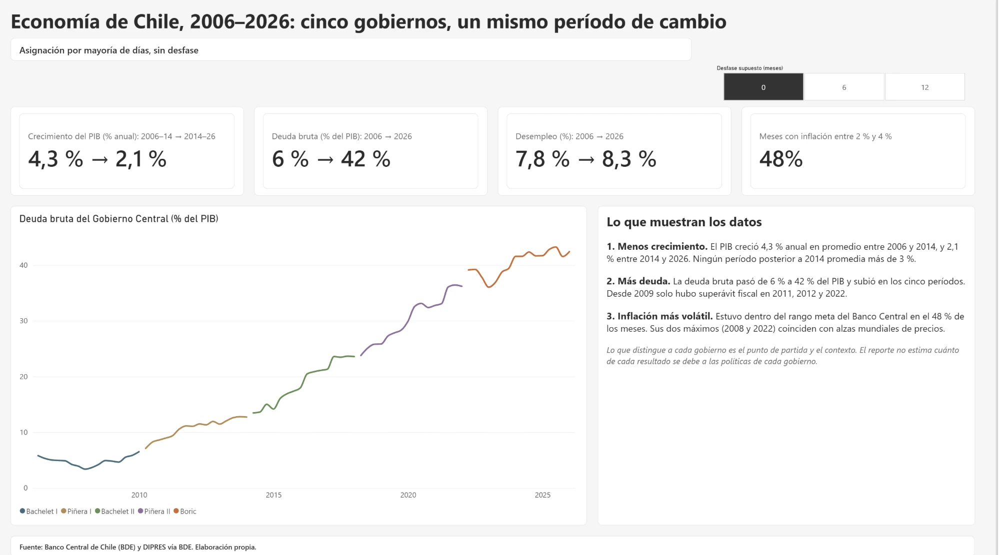
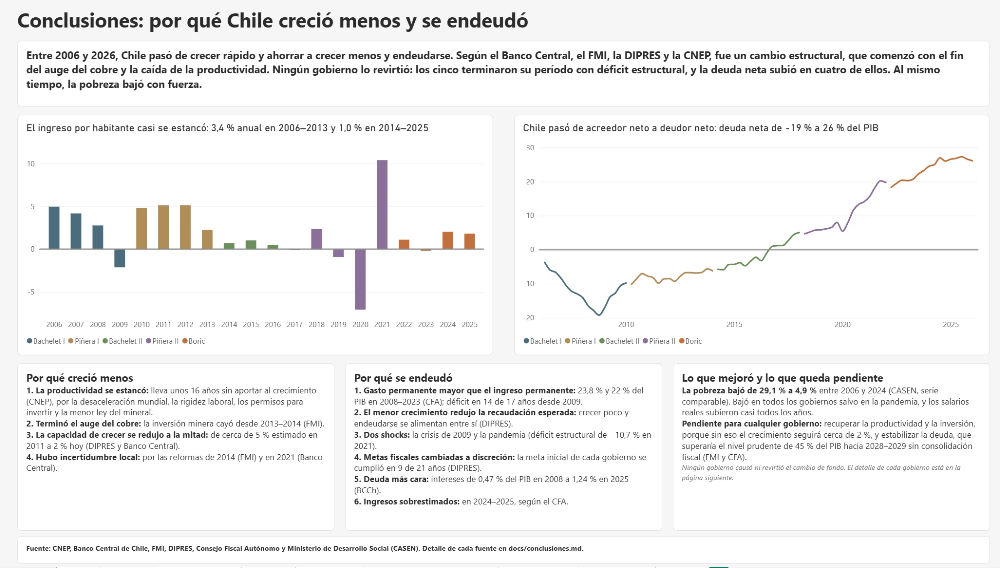
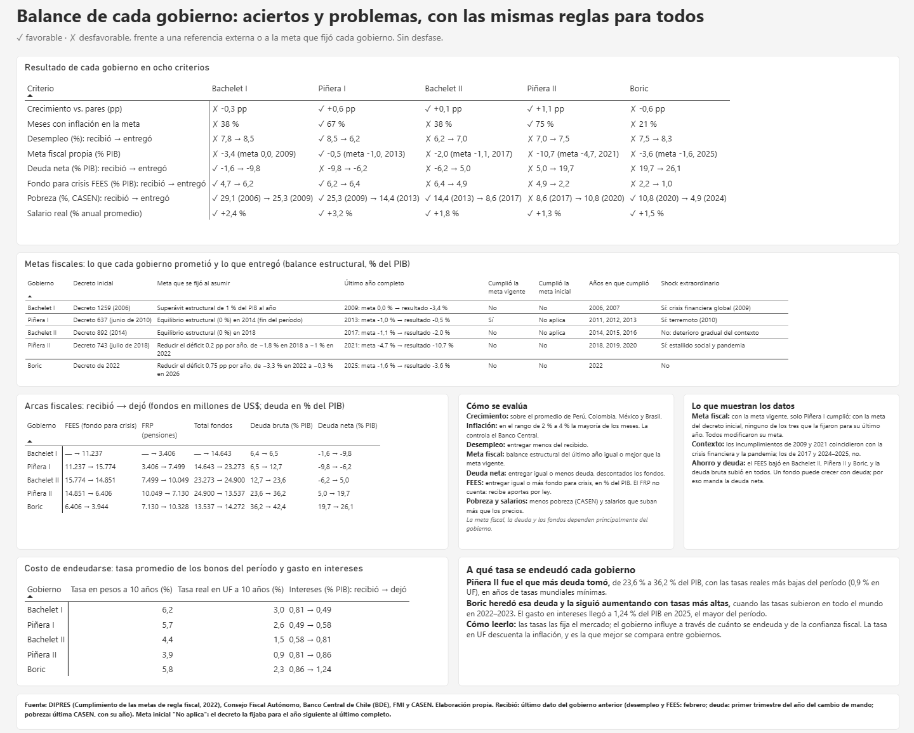
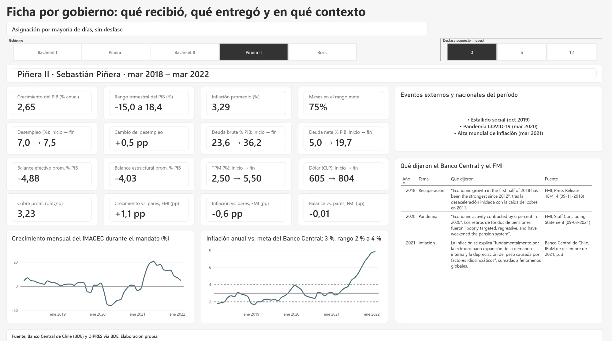
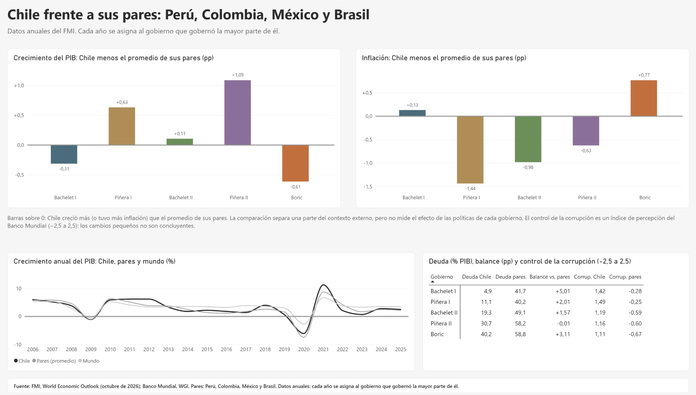
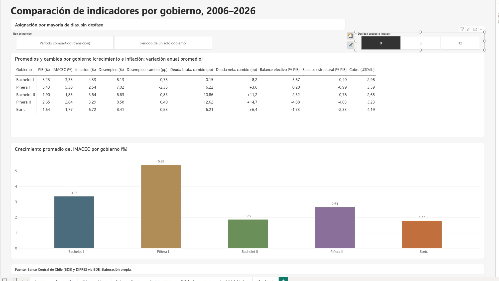
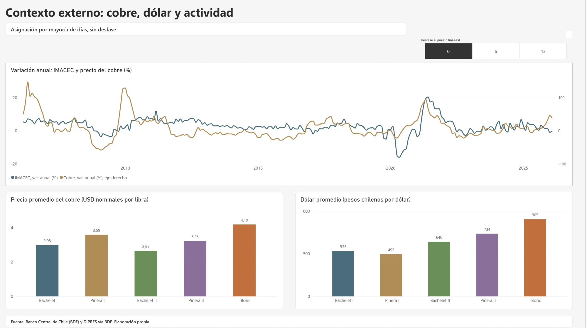
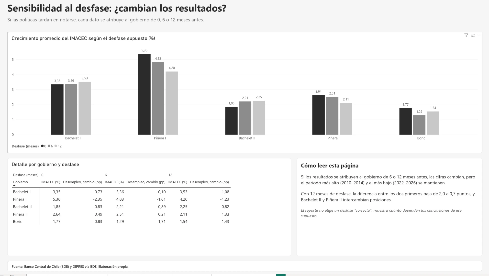
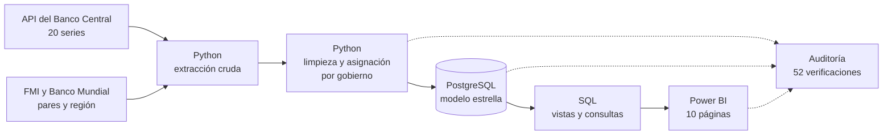

# La economía de Chile en cinco gobiernos (2006–2026)

Análisis de punta a punta del crecimiento, la inflación, el empleo y las finanzas públicas
de Chile durante los gobiernos de Bachelet I, Piñera I, Bachelet II, Piñera II y Boric. Usa
datos oficiales y muestra el contexto que enfrentó cada gobierno: el precio del cobre, las
crisis externas y lo que pasaba al mismo tiempo en países comparables.

**Python · PostgreSQL · SQL · Power BI · Git**



---

## La pregunta

¿Cómo evolucionó la economía chilena entre 2006 y 2026, y cuánto de lo que le tocó a cada
gobierno fue propio de Chile y cuánto fue contexto?

El análisis es **descriptivo y neutral**: aplica las mismas reglas a los cinco gobiernos,
compara contra referencias externas (la meta del Banco Central, lo que cada gobierno
recibió y lo que pasó en los países vecinos). Las cifras son resultados propios; las causas
vienen de las instituciones técnicas que se citan, no del autor.

## La conclusión

> **Entre 2006 y 2026, Chile pasó de crecer rápido y ahorrar a crecer menos y endeudarse.
> Según el Banco Central, el FMI, la DIPRES y la CNEP, fue un cambio estructural, que comenzó
> con el fin del auge del cobre y la caída de la productividad. Ningún gobierno lo revirtió:
> los cinco terminaron su período con déficit estructural, y la deuda neta subió en cuatro de
> ellos. Al mismo tiempo, la pobreza bajó con fuerza.**

**Por qué creció menos** (según las fuentes citadas)**:**
- **La productividad lleva unos 16 años estancada,** según la CNEP: por la desaceleración
  mundial, la rigidez laboral, los permisos para invertir y la menor ley del mineral.
- **Terminó el auge del cobre y cayó la inversión minera** (FMI).
- **La capacidad de crecer se redujo a la mitad:** de cerca de 5 % estimado en 2011 a cerca de 2 % en las estimaciones actuales
  (DIPRES y Banco Central).
- **El ingreso por habitante casi se estancó:** creció 3,4 % al año entre 2006 y 2013, y 1,0 %
  entre 2014 y 2025, con caídas en 2017, 2019, 2020 y 2023.

**Por qué se endeudó** (según las fuentes citadas)**:**
- **El gasto superó a los ingresos permanentes:** 23,8 % del PIB frente a 22 % en promedio
  entre 2008 y 2023 (CFA). Hubo déficit efectivo en 14 de los 17 años entre 2009 y 2025.
- **El menor crecimiento redujo la recaudación esperada.** El bajo crecimiento y la deuda se
  alimentan entre sí.
- **Dos shocks** (la crisis de 2009 y la pandemia) y una regla fiscal cuyas metas se cambiaban a
  discreción (DIPRES).
- **La deuda se volvió más cara.** Piñera II fue el que más deuda sumó, con las tasas reales
  más bajas del período (0,9 % en UF a 10 años). Desde 2022 las tasas subieron en todo el mundo, y
  el gasto en intereses llegó a 1,24 % del PIB en 2025, el más alto desde 2005.

**Lo que mejoró:** la pobreza por ingresos bajó de 29,1 % en 2006 a 4,9 % en 2024, en la medición
comparable de la CASEN. Bajó en todos los gobiernos salvo en la pandemia. Los salarios reales
subieron en casi todos los años.

La explicación completa, gobierno por gobierno y con cada fuente, está en
[docs/conclusiones.md](docs/conclusiones.md).

## Lo que muestran los datos

**1. La economía cambió de régimen, y el cambio atraviesa a los cinco gobiernos.**
- El PIB creció **4,3 %** anual en promedio entre 2006 y 2014, y **2,1 %** entre 2014 y 2026.
- La deuda bruta del Gobierno Central pasó de **6 % a 42 % del PIB**.
- La deuda neta pasó de **−19 % del PIB en 2008**, cuando el Fisco tenía más activos que
  deudas, a **26 %** a comienzos de 2026.
- La inflación estuvo dentro del rango meta del Banco Central (2 % a 4 %) en el **48 %** de
  los meses. Sus dos máximos (2008 y 2022) coinciden con alzas mundiales de precios.

**2. El contexto cambia la lectura de varios resultados.**
- En promedio, el superávit fiscal efectivo de Bachelet I (**+3,7 % del PIB**) fue un pequeño
  déficit estructural (**−0,4 %**): la diferencia la explican los ingresos del cobre. Hubo
  superávit estructural en 2006–2007 y déficit en 2008–2009.
- Bachelet II tiene el crecimiento más bajo en cifras absolutas, pero la región creció aún
  menos, y Chile quedó levemente sobre sus pares.
- La caída de 2020 fue mundial. Frente a Perú, Colombia, México y Brasil, Piñera II es el
  período con la mayor diferencia de crecimiento a favor de Chile (+1,1 puntos).
- En 2022–2025, el crecimiento de Chile quedó bajo el de sus pares y la inflación sobre la
  de ellos, mientras el déficit fiscal fue bastante menor.

**3. Cada gobierno tuvo aciertos y problemas, y el más claro es la meta fiscal.** Es lo
que más depende del gobierno, y se compara con la meta que cada uno fijó en su propio
decreto. Con la meta vigente al final del período **solo Piñera I la cumplió**; con la meta
del decreto inicial, **ninguno de los tres que la fijaron para su último año** (Piñera I y
Bachelet II la fijaron para el año siguiente). Los incumplimientos de 2009 y 2021
coincidieron con la crisis financiera y la pandemia; los de 2017 y 2024–2025, no. Los ocho criterios, aplicados
a los cinco gobiernos:

| Criterio | Bachelet I | Piñera I | Bachelet II | Piñera II | Boric |
|---|---|---|---|---|---|
| Crecimiento frente a sus pares | ✗ −0,3 pp | ✓ +0,6 pp | ✓ +0,1 pp | ✓ +1,1 pp | ✗ −0,6 pp |
| Inflación en el rango meta | ✗ 38 % | ✓ 67 % | ✗ 38 % | ✓ 75 % | ✗ 21 % |
| Desempleo: recibió → entregó | ✗ 7,8 → 8,5 | ✓ 8,5 → 6,2 | ✗ 6,2 → 7,0 | ✗ 7,0 → 7,5 | ✗ 7,5 → 8,3 |
| Meta fiscal propia | ✗ 0,0 → −3,4 | ✓ −1,0 → −0,5 | ✗ −1,05 → −2,0 | ✗ −4,7 → −10,7 | ✗ −1,6 → −3,6 |
| Deuda neta (% PIB) | ✓ −1,6 → −9,8 | ✗ −9,8 → −6,2 | ✗ −6,2 → 5,0 | ✗ 5,0 → 19,7 | ✗ 19,7 → 26,1 |
| Fondo para crisis FEES (% del PIB) | ✓ 4,7 → 6,2 | ✓ 6,2 → 6,4 | ✗ 6,4 → 4,9 | ✗ 4,9 → 2,2 | ✗ 2,2 → 1,0 |
| Pobreza (%, CASEN; año de la encuesta) | ✓ 29,1 (2006) → 25,3 (2009) | ✓ 25,3 (2009) → 14,4 (2013) | ✓ 14,4 (2013) → 8,6 (2017) | ✗ 8,6 (2017) → 10,8 (2020) | ✓ 10,8 (2020) → 4,9 (2024) |
| Salario real (% anual) | ✓ +2,4 | ✓ +3,2 | ✓ +1,8 | ✓ +1,3 | ✓ +1,5 |

**4. Aun así, no hay un "mejor gobierno".** Con cuatro años por gobierno, de las
10 comparaciones de crecimiento entre pares de gobiernos solo 2 superan su incertidumbre:
Piñera I creció más que Bachelet II y que Boric. Además, los criterios no pesan lo mismo:
el reporte muestra los aciertos y problemas de cada uno, pero no los suma en un puntaje.

El detalle de cada cifra está en [docs/hallazgos.md](docs/hallazgos.md) y la comparación
internacional en [docs/contexto_comparado.md](docs/contexto_comparado.md).

## Lo que el análisis no puede concluir

- **No separa causas:** no estima cuánto de cada resultado se debe a las políticas de cada
  gobierno, al ciclo externo o al Banco Central, que es autónomo.
- **Los efectos tardan:** las políticas se notan con rezago, y el dashboard muestra cómo
  cambian las cifras si se suponen 6 o 12 meses de desfase.
- **Hay eventos superpuestos:** el estallido social y la pandemia coinciden en 2020.
- **Mide el bienestar de forma parcial:** pobreza por ingresos y salarios reales, pero no
  desigualdad ni otras dimensiones de la calidad de vida.

Todas las limitaciones están en [docs/metodologia.md](docs/metodologia.md).

---

## El dashboard

Diez páginas en Power BI, con el mismo diseño, el mismo color para cada gobierno en todas
las páginas y orden cronológico, nunca de "mejor" a "peor".

| Página | Qué responde |
|---|---|
| Resumen | El cambio de régimen en cuatro cifras |
| Conclusiones | Por qué Chile creció menos y se endeudó, con sus causas y fuentes |
| Balance de cada gobierno | Aciertos y problemas con ocho criterios uniformes, metas fiscales, arcas fiscales y a qué tasa se endeudó cada gobierno |
| Comparación | Los indicadores principales de los cinco gobiernos, lado a lado |
| Ficha por gobierno | Qué recibió y qué entregó cada gobierno, en qué contexto y qué dijeron el Banco Central y el FMI |
| Series en el tiempo | Cada indicador mes a mes |
| Contexto externo | El cobre, el dólar y la actividad |
| Chile frente a sus pares | Si cada resultado fue propio de Chile o compartido con la región |
| Sensibilidad al desfase | Cuánto cambian las conclusiones según el rezago supuesto |
| Metodología | Las reglas del análisis y sus límites |









<details>
<summary>Ver las demás páginas</summary>







</details>

---

## Cómo se construyó



| Etapa | Qué se hizo | Dónde |
|---|---|---|
| Extracción | Cliente de la API del Banco Central; respuestas guardadas sin modificar | `src/extract/` |
| Limpieza | Formato largo, validaciones y asignación de cada dato a un gobierno | `src/transform/` |
| Carga | Modelo estrella con restricciones y carga transaccional | `src/load/`, `sql/01_schema.sql` |
| Análisis | Vistas reutilizables y ocho consultas por tema | `sql/02_views.sql`, `sql/analisis/` |
| Dashboard | Proyecto `.pbip`: modelo y páginas versionados como texto | `dashboard/` |
| Calidad | 44 tests y una auditoría que verifica cada cifra por un camino independiente | `tests/`, `src/analysis/auditoria.py` |

### Decisiones clave

| Decisión | Por qué |
|---|---|
| Cada dato va al gobierno que gobernó **la mayoría de los días** de su período | El cambio de mando es el 11 de marzo; un mes o trimestre puede tocar a dos gobiernos |
| Desfase de 0, 6 o 12 meses, sin imponer uno | Las políticas tardan en notarse y no hay un rezago único |
| Variaciones anuales en vez de promedios de nivel | El nivel del PIB crece con el tiempo y favorecería siempre al gobierno más reciente |
| "Recibió → entregó" en vez de promedios del período | Mide el cambio durante el mandato a partir de su punto de partida |
| Balance estructural junto al efectivo | El efectivo depende del cobre y del ciclo; el estructural es la meta de la regla fiscal |
| Comparación con Perú, Colombia, México y Brasil | Separa una parte del contexto externo del resultado propio de Chile |
| Citas textuales del Banco Central y del FMI | Explicar cada período en palabras de las instituciones técnicas, no del autor |
| Cada gobierno frente a su propia meta fiscal | Es el criterio más neutral: la vara la fijó el mismo gobierno |
| Aciertos y problemas, sin puntaje total | Los criterios no pesan lo mismo, y la mayoría de las diferencias de crecimiento no supera su incertidumbre |

## Calidad de los datos

La auditoría ([`src/analysis/auditoria.py`](src/analysis/auditoria.py)) verifica cada cifra
por un camino distinto al que la produjo. Resultado: **52 de 52 verificaciones correctas.**

- Cada valor del CSV es idéntico a la respuesta original de la API.
- La asignación a gobiernos se reimplementó con otro método: 0 diferencias en 18.568 filas.
- Las series de Chile coinciden con el FMI y con cifras publicadas por el INE.
- 96 métricas por gobierno calculadas en Python coinciden con las vistas SQL.
- 142 cifras de las tablas de los hallazgos coinciden con el cálculo independiente.
- 79 valores del dashboard, anotados a mano desde Power BI Desktop, coinciden con el cálculo
  sin DAX ([valores esperados por tarjeta](docs/valores_dashboard.md)). La auditoría no abre
  el informe: si el dashboard cambia, esos valores se vuelven a anotar.
- Las verificaciones que comparan contra las vistas SQL necesitan la base PostgreSQL cargada.

**La auditoría encontró un error real.** La primera versión usaba una serie de inflación
"empalmada" por el Banco Central que difería hasta 1,3 puntos de la cifra oficial del INE en
los años de cambio de canasta. Por ejemplo, para diciembre de 2009 daba −2,6 %, cuando el
INE publicó −1,4 %. Se reemplazó por la serie oficial. El proceso completo está en la
[bitácora del proyecto](docs/bitacora_del_proyecto.md).

---

## Cómo reproducirlo

Requisitos: Python 3.12, PostgreSQL (probado con la versión 18) y Power BI Desktop. Antes
de empezar, crea en PostgreSQL una base vacía llamada `economia_chile`.

```bash
python -m venv venv
venv\Scripts\activate
pip install -r requirements.txt
copy .env.example .env
python -m src.load.postgres
python -m src.analysis.ejecutar_consultas
python -m src.analysis.auditoria
python -m pytest
```

Antes de cargar la base, completa en `.env` los datos de tu PostgreSQL. Los datos limpios
están versionados en `data/processed/`, así que **no hace falta una cuenta de la API** del
Banco Central. Para descargarlos de nuevo:

```bash
python -m src.extract.run_bcch
python -m src.transform.clean
python -m src.extract.internacional
```

Después abre `dashboard/chile_economia.pbip` en Power BI Desktop y haz clic en
**Inicio → Actualizar**.

## Estructura del repositorio

```
config/series.yaml          Catálogo de series y códigos de la API
data/reference/             Gobiernos, eventos, países pares y citas oficiales
data/processed/             Datos limpios (versionados)
src/extract/                Extracción: Banco Central, FMI y Banco Mundial
src/transform/              Limpieza y asignación por gobierno
src/load/                   Carga en PostgreSQL
src/analysis/               Consultas, auditoría y valores esperados del dashboard
sql/                        Esquema, vistas y consultas de análisis
tests/                      Tests de la asignación, los datos internacionales y las metas fiscales
dashboard/                  Proyecto de Power BI (.pbip), tema y capturas
dashboard/generador/        Script que genera las páginas del reporte (PBIR) desde código
docs/                       Metodología, hallazgos, bitácora y auditoría
```

## Fuentes

- **Banco Central de Chile,** Base de Datos Estadísticos (API BDE): PIB, IMACEC, TPM, dólar,
  cobre y desempleo (INE). También las series fiscales de la DIPRES: deuda bruta y neta, y
  balance efectivo y estructural. Saldos del FEES y del FRP (Ministerio de Hacienda). Tasas de
  mercado de los bonos a 10 años en pesos y en UF, gasto en intereses y PIB nominal.
- **DIPRES y Consejo Fiscal Autónomo:** metas fiscales de cada gobierno y su cumplimiento
  ([docs/metas_fiscales.md](docs/metas_fiscales.md)).
- **INE:** IPC (variación a 12 meses oficial) e índice real de remuneraciones, vía la BDE.
- **Ministerio de Desarrollo Social:** pobreza por ingresos de la encuesta CASEN
  ([`data/reference/pobreza_casen.csv`](data/reference/pobreza_casen.csv)).
- **CNEP, Banco Central y FMI:** productividad y crecimiento tendencial, para las causas.
- **FMI,** World Economic Outlook (octubre de 2026): comparación con países pares.
- **Banco Mundial,** Worldwide Governance Indicators: control de la corrupción.
- **Citas:** informes del Banco Central (IPoM y Boletín Mensual) y del FMI (consultas del
  Artículo IV), con enlace en [`data/reference/explicaciones.csv`](data/reference/explicaciones.csv).

## Extensiones posibles

Tipo de cambio real, cobre en dólares reales, inversión y un contrafactual formal (control
sintético). El detalle de cada una está en
[docs/metodologia.md](docs/metodologia.md).

## Licencia

El código está bajo licencia MIT (ver [LICENSE](LICENSE)). Los datos pertenecen a sus
fuentes originales: Banco Central de Chile, INE, DIPRES, Consejo Fiscal Autónomo,
Ministerio de Desarrollo Social, FMI y Banco Mundial.
