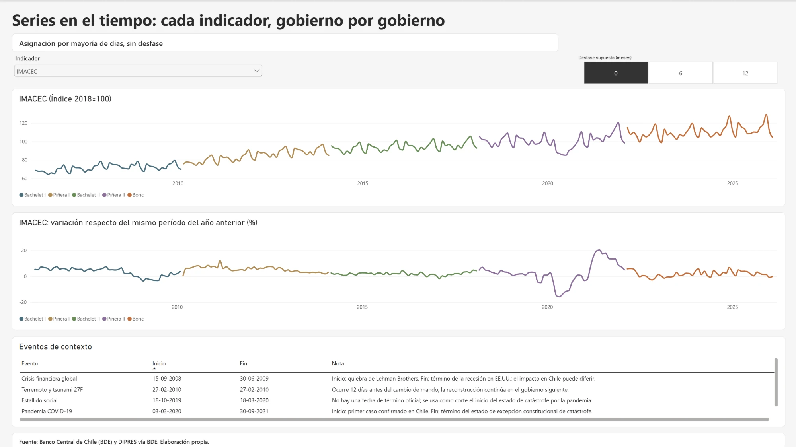
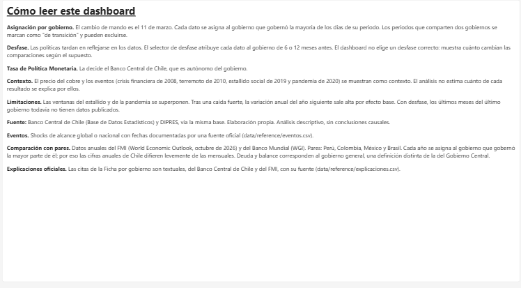

# La economía de Chile en cinco gobiernos (2006–2026)

Análisis de punta a punta del crecimiento, la inflación, el empleo y las finanzas públicas
de Chile durante los gobiernos de Bachelet I, Piñera I, Bachelet II, Piñera II y Boric. Usa
datos oficiales y muestra el contexto que enfrentó cada gobierno: el precio del cobre, las
crisis externas y lo que pasaba al mismo tiempo en países comparables.

**Python · PostgreSQL · SQL · Power BI · Git**


---

## La pregunta

¿Cómo evolucionó la economía chilena entre 2006 y 2026, y cuánto de lo que le tocó a cada
gobierno fue propio de Chile y cuánto fue contexto?

El análisis es **descriptivo y neutral**: aplica las mismas reglas a los cinco gobiernos,
compara contra referencias externas (la meta del Banco Central, lo que cada gobierno
recibió y lo que pasó en los países vecinos) y no atribuye causas.

## Lo que muestran los datos

**1. La economía cambió de régimen, y el cambio atraviesa a los cinco gobiernos.**
- El PIB creció **4,3 %** anual en promedio entre 2006 y 2014, y **2,1 %** entre 2014 y 2026.
- La deuda bruta del Gobierno Central pasó de **6 % a 42 % del PIB**.
- La deuda neta pasó de **−19 % del PIB en 2008**, cuando el Fisco tenía más activos que
  deudas, a **26 %** a comienzos de 2026.
- La inflación estuvo dentro del rango meta del Banco Central (2 % a 4 %) en el **48 %** de
  los meses. Sus dos máximos (2008 y 2022) coinciden con alzas mundiales de precios.

**2. El contexto cambia la lectura de varios resultados.**
- El superávit fiscal de Bachelet I (**+3,7 % del PIB**) fue un pequeño déficit en términos
  estructurales (**−0,4 %**): lo explicaron los ingresos del cobre.
- Bachelet II tiene el crecimiento más bajo en cifras absolutas, pero la región creció aún
  menos, y Chile quedó levemente sobre sus pares.
- La caída de 2020 fue mundial. Frente a Perú, Colombia, México y Brasil, Piñera II es el
  período con la mayor diferencia de crecimiento a favor de Chile (+1,1 puntos).
- En 2022–2025, el crecimiento de Chile quedó bajo el de sus pares y la inflación sobre la
  de ellos, mientras el déficit fiscal fue bastante menor.

**3. Los datos no permiten ordenar a los gobiernos.** Con cuatro años por gobierno, de las
10 comparaciones de crecimiento entre pares de gobiernos solo 2 superan su incertidumbre:
Piñera I creció más que Bachelet II y que Boric. Por eso el reporte no construye un ranking.

El detalle de cada cifra está en [docs/hallazgos.md](docs/hallazgos.md) y la comparación
internacional en [docs/contexto_comparado.md](docs/contexto_comparado.md).

## Lo que el análisis no puede concluir

- **No separa causas:** no estima cuánto de cada resultado se debe a las políticas de cada
  gobierno, al ciclo externo o al Banco Central, que es autónomo.
- **Los efectos tardan:** las políticas se notan con rezago, y el dashboard muestra cómo
  cambian las cifras si se suponen 6 o 12 meses de desfase.
- **Hay eventos superpuestos:** el estallido social y la pandemia coinciden en 2020.
- **No mide bienestar ni distribución,** solo indicadores macroeconómicos.

Todas las limitaciones están en [docs/metodologia.md](docs/metodologia.md).

---

## El dashboard

Ocho páginas en Power BI, con el mismo diseño, el mismo color para cada gobierno en todas
las páginas y orden cronológico, nunca de "mejor" a "peor".

| Página | Qué responde |
|---|---|
| Resumen | El cambio de régimen en cuatro cifras |
| Comparación | Los indicadores principales de los cinco gobiernos, lado a lado |
| Ficha por gobierno | Qué recibió y qué entregó cada gobierno, en qué contexto y qué dijeron el Banco Central y el FMI |
| Series en el tiempo | Cada indicador mes a mes |
| Contexto externo | El cobre, el dólar y la actividad |
| Chile frente a sus pares | Si cada resultado fue propio de Chile o compartido con la región |
| Sensibilidad al desfase | Cuánto cambian las conclusiones según el rezago supuesto |
| Metodología | Las reglas del análisis y sus límites |


<details>
<summary>Ver las demás páginas</summary>






</details>

---

## Cómo se construyó


| Etapa | Qué se hizo | Dónde |
|---|---|---|
| Extracción | Cliente de la API del Banco Central; respuestas guardadas sin modificar | `src/extract/` |
| Limpieza | Formato largo, validaciones y asignación de cada dato a un gobierno | `src/transform/` |
| Carga | Modelo estrella con restricciones y carga transaccional | `src/load/`, `sql/01_schema.sql` |
| Análisis | Vistas reutilizables y ocho consultas por tema | `sql/02_views.sql`, `sql/analisis/` |
| Dashboard | Proyecto `.pbip`: modelo y páginas versionados como texto | `dashboard/` |
| Calidad | 31 tests y una auditoría que verifica cada cifra por un camino independiente | `tests/`, `src/analysis/auditoria.py` |

### Decisiones clave

| Decisión | Por qué |
|---|---|
| Cada dato va al gobierno que gobernó **la mayoría de los días** de su período | El cambio de mando es el 11 de marzo; un mes o trimestre puede tocar a dos gobiernos |
| Desfase de 0, 6 o 12 meses, sin imponer uno | Las políticas tardan en notarse y no hay un rezago único |
| Variaciones anuales en vez de promedios de nivel | El nivel del PIB crece con el tiempo y favorecería siempre al gobierno más reciente |
| "Recibió → entregó" en vez de promedios del período | Mide el cambio durante el mandato a partir de su punto de partida |
| Balance estructural junto al efectivo | El efectivo depende del cobre y del ciclo; el estructural es la meta de la regla fiscal |
| Comparación con Perú, Colombia, México y Brasil | Separa una parte del contexto externo del resultado propio de Chile |
| Citas textuales del Banco Central y del FMI | Explicar cada período en palabras de las instituciones técnicas, no del autor |
| Sin ranking de gobiernos | Ningún período destaca en todos los indicadores, y la mayoría de las diferencias no supera su incertidumbre |

## Calidad de los datos

La auditoría ([`src/analysis/auditoria.py`](src/analysis/auditoria.py)) verifica cada cifra
por un camino distinto al que la produjo. Resultado: **32 de 32 verificaciones correctas.**

- Cada valor del CSV es idéntico a la respuesta original de la API.
- La asignación a gobiernos se reimplementó con otro método: 0 diferencias en 12.231 filas.
- Las series de Chile coinciden con el FMI y con cifras publicadas por el INE.
- 55 métricas por gobierno calculadas en Python coinciden con las vistas SQL.
- 120 cifras de los hallazgos y 79 valores leídos en el dashboard coinciden con el cálculo
  independiente ([valores esperados por tarjeta](docs/valores_dashboard.md)).

**La auditoría encontró un error real.** La primera versión usaba una serie de inflación
"empalmada" por el Banco Central que difería hasta 1,3 puntos de la cifra oficial del INE en
los años de cambio de canasta. Por ejemplo, para diciembre de 2009 daba −2,6 %, cuando el
INE publicó −1,4 %. Se reemplazó por la serie oficial. El proceso completo está en la
[bitácora del proyecto](docs/bitacora_del_proyecto.md).

---

## Cómo reproducirlo

Requisitos: Python 3.12, PostgreSQL (probado con la versión 18) y Power BI Desktop. Antes
de empezar, crea en PostgreSQL una base vacía llamada `economia_chile`.

```bash
python -m venv venv
venv\Scripts\activate
pip install -r requirements.txt
copy .env.example .env
python -m src.load.postgres
python -m src.analysis.ejecutar_consultas
python -m src.analysis.auditoria
python -m pytest
```

Antes de cargar la base, completa en `.env` los datos de tu PostgreSQL. Los datos limpios
están versionados en `data/processed/`, así que **no hace falta una cuenta de la API** del
Banco Central. Para descargarlos de nuevo:

```bash
python -m src.extract.run_bcch
python -m src.transform.clean
python -m src.extract.internacional
```

Después abre `dashboard/chile_economia.pbip` en Power BI Desktop y haz clic en
**Inicio → Actualizar**.

## Estructura del repositorio

```
config/series.yaml          Catálogo de series y códigos de la API
data/reference/             Gobiernos, eventos, países pares y citas oficiales
data/processed/             Datos limpios (versionados)
src/extract/                Extracción: Banco Central, FMI y Banco Mundial
src/transform/              Limpieza y asignación por gobierno
src/load/                   Carga en PostgreSQL
src/analysis/               Consultas, auditoría y valores esperados del dashboard
sql/                        Esquema, vistas y consultas de análisis
tests/                      Tests de la asignación y de los datos internacionales
dashboard/                  Proyecto de Power BI (.pbip), tema y capturas
docs/                       Metodología, hallazgos, bitácora y auditoría
```

## Fuentes

- **Banco Central de Chile,** Base de Datos Estadísticos (API BDE): PIB, IMACEC, TPM, dólar,
  cobre y desempleo (INE). También las series fiscales de la DIPRES: deuda bruta y neta, y
  balance efectivo y estructural.
- **INE:** IPC, variación a 12 meses oficial, obtenido vía la BDE.
- **FMI,** World Economic Outlook (octubre de 2026): comparación con países pares.
- **Banco Mundial,** Worldwide Governance Indicators: control de la corrupción.
- **Citas:** informes del Banco Central (IPoM y Boletín Mensual) y del FMI (consultas del
  Artículo IV), con enlace en [`data/reference/explicaciones.csv`](data/reference/explicaciones.csv).

## Extensiones posibles

Tipo de cambio real, cobre en dólares reales, inversión, salarios reales y un contrafactual
formal (control sintético). El detalle de cada una está en
[docs/metodologia.md](docs/metodologia.md).

## Licencia

El código está bajo licencia MIT (ver [LICENSE](LICENSE)). Los datos pertenecen a sus
fuentes originales: Banco Central de Chile, INE, DIPRES, FMI y Banco Mundial.
